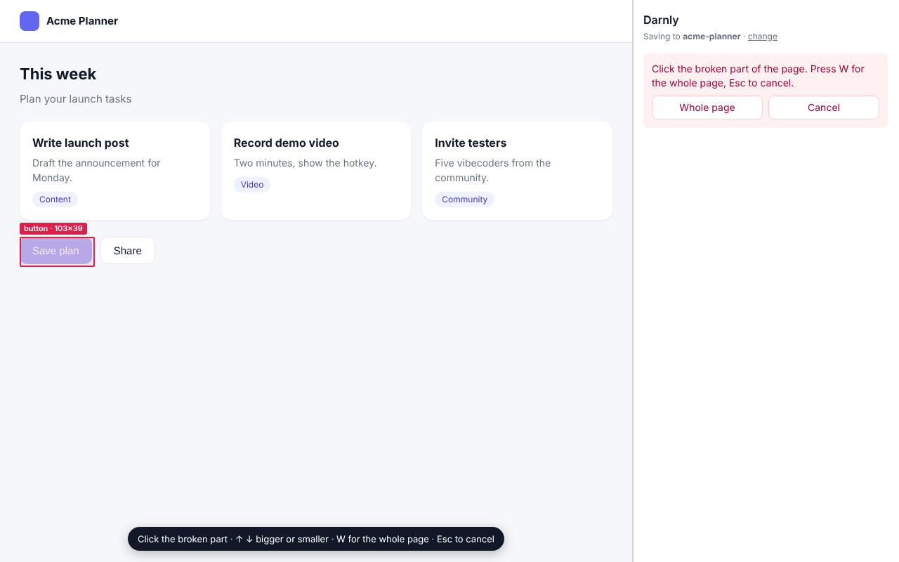

# Darnly: bug reports for AI coding agents

See something broken on a page? Press one key, click it, and say what you expected. Claude Code, Codex or Cursor gets a report it can work from: a screenshot with the broken part boxed, the element, the page address, and the console errors and failed requests from the last 60 seconds.

Made for people who build apps with AI coding agents, developer or not.

**[Add Darnly to Chrome (free)](https://chromewebstore.google.com/detail/darnly/gognoljafcabnmbbpfoeeamcflpbgidj)** · [darnly.dev](https://darnly.dev) · [Setup guide](https://darnly.dev/setup/) · [Free tools for vibecoders](https://darnly.dev/tools/) · [@darnlyhq](https://x.com/darnlyhq)

## How it works

1. Press **Option+Shift+B** on a Mac (Windows is coming soon) on any page, on localhost or your live site.
2. Click the broken part. Arrow keys make the box bigger or smaller, W picks the whole page, Esc cancels.
3. Type what you expected and press Enter.

Where the report goes:

- **Code on your computer:** link your project folder once. Each bug lands as plain files in `.darnly/inbox/` (Markdown plus a PNG), and **Set up this project** adds a short note to `AGENTS.md`, a `/darnly` command for Claude Code and Cursor, and a Claude Code hook that tells the agent when bugs are waiting. Then type `/darnly` (in Codex, say "fix my Darnly bugs").
- **Code in the cloud:** sign in once and bugs go to your private Darnly inbox. Add the connector `https://api.darnly.dev/mcp` to your agent ([how, for each agent](https://darnly.dev/setup/)) (tools: `list_bugs`, `get_bug`, `ask_user`, `mark_fixed`), or copy the picture and the details into your agent's chat.

When the agent fixes a bug, the Darnly panel says "1 bug fixed. Take a look." with one line on what changed. If the agent has a question, the panel tells you to go back to its chat.

Bugs from all your projects stay in one list. Console errors are recorded on localhost automatically; for a live site, click **Record errors on this site** once. Passwords, tokens and API keys are hidden before anything is saved. See [PRIVACY.md](PRIVACY.md).

Works in Chrome, Edge, Brave and Arc. There is also a Mac app for the iOS Simulator, the Android Emulator and Mac apps: see [mac/README.md](mac/README.md).

## Developing

### Load an unpacked build

1. `npm install`, then `npm run build`.
2. Open `chrome://extensions`, switch on **Developer mode**, click **Load unpacked**, and pick `.output/chrome-mv3/`.
3. Check the shortcut at `chrome://extensions/shortcuts`.

### Renaming the product

The name lives in one file: `src/config/product.ts`. Change `NAME` and `SLUG` there.
The extension name, the `.<slug>/` folder, the AGENTS.md markers and the skill paths all follow.
(`spike/folder-test/` is a throwaway test and has its own copy.)

### Commands

- `npm install` once
- `npm run dev` opens Chrome with the extension, reloading on save
- `npm run build` builds into `.output/chrome-mv3/` (load it at chrome://extensions with "Load unpacked")
- `npm test` runs the unit tests
- `npm run zip` makes the store zip in `.output/`
- Store listing text: `store/listing.md`

### Folders

- `src/config/product.ts`: product name
- `src/entrypoints/`: background (hotkey, screenshot), picker (content script), side panel (note box, saving), keepalive (holds folder access)
- `tests/e2e/`: `npm run e2e` captures a planted bug on a sample page and checks the files
- `src/lib/`: pure helpers with unit tests
- `spike/folder-test/`: day-one folder-write test (no build step; load the folder unpacked)
- `benchmark/`: does a Darnly report make Claude Code search less and spend fewer tokens than a plain description? See `benchmark/README.md`
